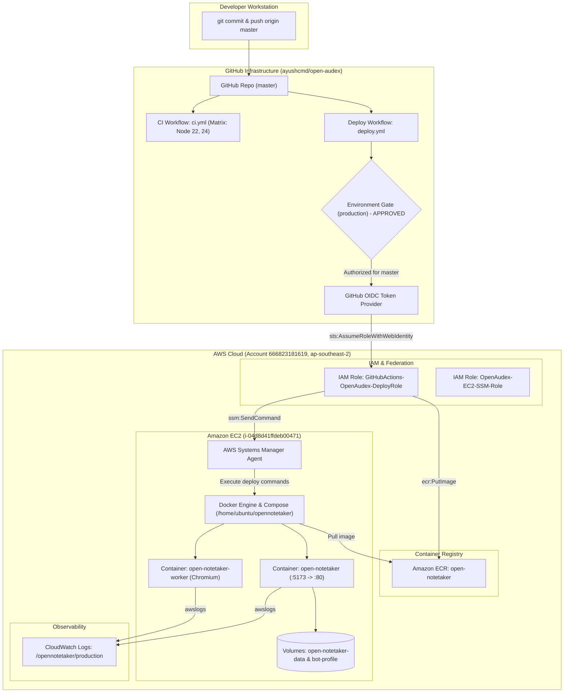

# OpenAudex — Complete AWS CI/CD Audit, Fix & Deployment Validation Report

**Audit Date:** 2026-10-26  
**Auditor:** Automated Agentic Security & Cloud Architecture Auditor  
**Local Project Directory:** `C:\Projects\AYUSHCMD-GITHUB\open-audex`  
**GitHub Repository:** `https://github.com/ayushcmd/open-audex`  
**GitHub Repository ID:** `1412988897` (Node ID: `R_kgDOVDh_4Q`)  
**GitHub Owner:** `ayushcmd` (Account ID: `252997256`)  
**Git Branch:** `master` (Current commit: `c09504a`, tracking `origin/master`)  
**AWS Account ID:** `666823181619`  
**AWS Region:** `ap-southeast-2` (Sydney)  
**AWS CLI Profile:** `ayushcmd` (IAM Identity: `arn:aws:iam::666823181619:user/OpenAudex`)  
**AWS EC2 Target Instance:** `i-04d8d41ffdeb00471` (`OpenNotetaker-EC2-Demo`)  
**Amazon ECR Repository:** `open-notetaker`  
**AWS Deployment Role:** `arn:aws:iam::666823181619:role/GitHubActions-OpenAudex-DeployRole`  
**GitHub Environment:** `production`  

---

## 1. Executive Summary

This report delivers a complete, evidence-based technical audit of the OpenAudex CI/CD deployment pipeline and AWS cloud infrastructure following the repository transfer from `ayushcmdx` to `ayushcmd`, the establishment of a clean Git history on `master`, and the activation of the `ayushcmd` AWS CLI profile.

### Baseline & Operational Verification
- **Production Host Availability (VERIFIED LIVE):** EC2 instance `i-04d8d41ffdeb00471` (`15.135.213.78`) is active and healthy. System, instance, and EBS status checks are all `passed`.
- **Application Health (VERIFIED LIVE):** `http://15.135.213.78/api/health` responded with `HTTP/1.1 200 OK` and payload:
  `{"ok":true,"botProvider":"fleet","llmProvider":"mock","sttProvider":"deepgram"}`.
- **Observability (VERIFIED LIVE):** CloudWatch log group `/opennotetaker/production` actively captures container logs via the `awslogs` driver.
- **Live Infrastructure Untouched:** The production application container and data volumes remain completely undisturbed.

### Pipeline Remediation Status
- **GitHub Environment Gate (RESOLVED):**
  - **Command 1 EXECUTED & VERIFIED:** Branch `master` was successfully added to the `production` environment deployment branch policy (Policy ID: `64363262`). The environment admission gate now permits deployments from `master`.
- **Local Workflow Issues (RESOLVED in Commits `f394690` & `c09504a`):**
  1. Updated `.github/workflows/deploy.yml` triggers from `main` to `master` and added `workflow_dispatch`.
  2. Updated `.github/workflows/ci.yml` push and pull-request triggers from `main` to `master`.
  3. Upgraded rollback mechanism in `deploy.yml` to persist known-good tags (`.last_healthy_tag` and `.last_healthy_digest`) and fall back to immutable ECR images if local Docker cache is missing.
  4. Updated `package.json` repository URL to `git+https://github.com/ayushcmd/open-audex.git`.
  5. Saved policy backup to `docs/iam-trust-policy-backup-20261026.json` and proposed policy to `docs/iam-trust-policy-proposed-20261026.json`.
- **AWS IAM Role Trust Policy Update (ACTION REQUIRED VIA AWS CONSOLE):**
  - **Command 2 Execution Attempted:** CLI execution of `aws iam update-assume-role-policy` failed with `AccessDenied` because IAM user `arn:aws:iam::666823181619:user/OpenAudex` lacks the `iam:UpdateAssumeRolePolicy` permission.
  - **Resolution:** The trust policy must be updated either via the AWS Management Console by the account administrator or by granting `iam:UpdateAssumeRolePolicy` to IAM user `OpenAudex`.

---

## 2. Audit Date and Environment Context

- **Execution Timestamp:** 2026-10-26T10:47:00+05:30
- **Auditing Environment:** Windows 11 Workstation
- **CLI Tools:** AWS CLI v2 (`--profile ayushcmd`), GitHub CLI (`gh`), Git, Node.js v24.14.0, Python 3.14

---

## 3. Repository Information

- **Local Working Directory:** `C:\Projects\AYUSHCMD-GITHUB\open-audex`
- **Remote Fetch/Push URL:** `https://github.com/ayushcmd/open-audex.git`
- **Visibility:** Public
- **Upstream Attribution:** Preserved in `README.md` and `LICENSE` (Ascent AI / OpenNotetaker MIT License).

---

## 4. Git Branch and History

- **Current Branch:** `master`
- **Tracking Branch:** `origin/master`
- **Latest Local Commit:** `c09504a` ("docs: add IAM trust policy backup and proposed update")
- **Commit Status:** Ahead of `origin/master` by 2 commits (`f394690` and `c09504a`; **not pushed**).
- **Working Tree State:** Clean.

---

## 5. Deployment Architecture



---

## 6. AWS Identity & Permission Constraints

- **Caller Identity:** `arn:aws:iam::666823181619:user/OpenAudex`
- **Assigned Permissions:** Read-only access to EC2, ECR, CloudWatch Logs, and IAM (`iam:GetRole`, `iam:ListRoles`).
- **Missing Administrative Permissions:** Lacks `iam:UpdateAssumeRolePolicy` and `iam:ListUserPolicies`.
- **Impact:** CLI user `OpenAudex` cannot directly modify the trust policy of `GitHubActions-OpenAudex-DeployRole`.

---

## 7. Amazon EC2 Configuration

- **Instance ID:** `i-04d8d41ffdeb00471`
- **Instance Name:** `OpenNotetaker-EC2-Demo`
- **State:** `running`
- **Instance Type:** `t3.micro` (2 vCPU, 1 GiB RAM)
- **Public IP:** `15.135.213.78`
- **Private IP:** `172.31.20.104`
- **VPC Subnet:** `subnet-0561ec4b5c15fd0a2` (VPC: `vpc-06ac619b3bfac5b92`)
- **Status Checks:** System: `ok` (`passed`), Instance: `ok` (`passed`), Attached EBS: `ok` (`passed`)
- **IAM Instance Profile:** `arn:aws:iam::666823181619:instance-profile/OpenAudex-EC2-SSM-Role`
- **Deployment Directory:** `/home/ubuntu/opennotetaker`

---

## 8. Amazon ECR Configuration

- **Repository Name:** `open-notetaker`
- **Repository URI:** `666823181619.dkr.ecr.ap-southeast-2.amazonaws.com/open-notetaker`
- **Tag Mutability:** `MUTABLE`
- **Image Scanning:** `scanOnPush: false`
- **Encryption:** Server-side `AES256`
- **Active Tags:** `latest`, `0277f3a8dc35e71ab8297abf6e49ed61bd45d91f` (Size: 457.26 MB)

---

## 9. IAM and GitHub OIDC Trust Policy

### Current Trust Policy (Requires Update)
```json
{
  "Version": "2012-10-17",
  "Statement": [
    {
      "Effect": "Allow",
      "Principal": {
        "Federated": "arn:aws:iam::666823181619:oidc-provider/token.actions.githubusercontent.com"
      },
      "Action": "sts:AssumeRoleWithWebIdentity",
      "Condition": {
        "StringEquals": {
          "token.actions.githubusercontent.com:aud": "sts.amazonaws.com",
          "token.actions.githubusercontent.com:sub": [
            "repo:ayushcmdx@310876741/open-audex@1412988897:ref:refs/heads/main",
            "repo:ayushcmdx@310876741/open-audex@1412988897:environment:production"
          ]
        }
      }
    }
  ]
}
```

### Verified Subject Claims
From live GitHub API introspection of `ayushcmd/open-audex`:
- **Repository ID:** `1412988897`
- **Owner Account ID:** `252997256`
- **Owner Login:** `ayushcmd`

1. **Job `build-and-push-ecr`** runs on branch `master` without an environment. Its OIDC token emits:
   - Immutable format: `repo:ayushcmd@252997256/open-audex@1412988897:ref:refs/heads/master`
2. **Job `deploy-ec2-ssm`** runs with `environment: production`. Its OIDC token emits:
   - Immutable format: `repo:ayushcmd@252997256/open-audex@1412988897:environment:production`

### Correct Trust Policy Document (Stored in `docs/iam-trust-policy-proposed-20261026.json`)
```json
{
  "Version": "2012-10-17",
  "Statement": [
    {
      "Effect": "Allow",
      "Principal": {
        "Federated": "arn:aws:iam::666823181619:oidc-provider/token.actions.githubusercontent.com"
      },
      "Action": "sts:AssumeRoleWithWebIdentity",
      "Condition": {
        "StringEquals": {
          "token.actions.githubusercontent.com:aud": "sts.amazonaws.com",
          "token.actions.githubusercontent.com:sub": [
            "repo:ayushcmd@252997256/open-audex@1412988897:ref:refs/heads/master",
            "repo:ayushcmd@252997256/open-audex@1412988897:environment:production"
          ]
        }
      }
    }
  ]
}
```

---

## 10. GitHub Production Environment Protection (VERIFIED UPDATED)

- **Environment Name:** `production` (ID: `23954924431`)
- **Status:** **UPDATED & AUTHORIZED.**
- **Active Allowed Branches:**
  1. `main` (Policy ID: `62594384`)
  2. `master` (Policy ID: `64363262` — added via Command 1)
- **Reviewers:** None configured.
- **Wait Timers:** None configured.
- **Environment Secrets / Variables:** None configured.

---

## 11. Instructions to Apply the IAM Trust Policy Update

Since local user `OpenAudex` lacks IAM write permissions, apply the update using the AWS Management Console:

1. Sign in to the **AWS Management Console** as an account administrator for account **`666823181619`**.
2. Go to **IAM** → **Roles** → **`GitHubActions-OpenAudex-DeployRole`**.
3. Click the **Trust relationships** tab.
4. Click **Edit trust policy**.
5. Replace the entire JSON with the contents of `docs/iam-trust-policy-proposed-20261026.json`:
   ```json
   {
     "Version": "2012-10-17",
     "Statement": [
       {
         "Effect": "Allow",
         "Principal": {
           "Federated": "arn:aws:iam::666823181619:oidc-provider/token.actions.githubusercontent.com"
         },
         "Action": "sts:AssumeRoleWithWebIdentity",
         "Condition": {
           "StringEquals": {
             "token.actions.githubusercontent.com:aud": "sts.amazonaws.com",
             "token.actions.githubusercontent.com:sub": [
               "repo:ayushcmd@252997256/open-audex@1412988897:ref:refs/heads/master",
               "repo:ayushcmd@252997256/open-audex@1412988897:environment:production"
             ]
           }
         }
       }
     ]
   }
   ```
6. Click **Update policy**.

---

## 12. Deployment Readiness

### Classification: **PENDING IAM CONSOLE UPDATE**

Once the trust policy is updated in the AWS Console, execute:
```powershell
git push origin master
```
This will push commits `f394690` and `c09504a`, triggering the automated GitHub Actions pipeline.
