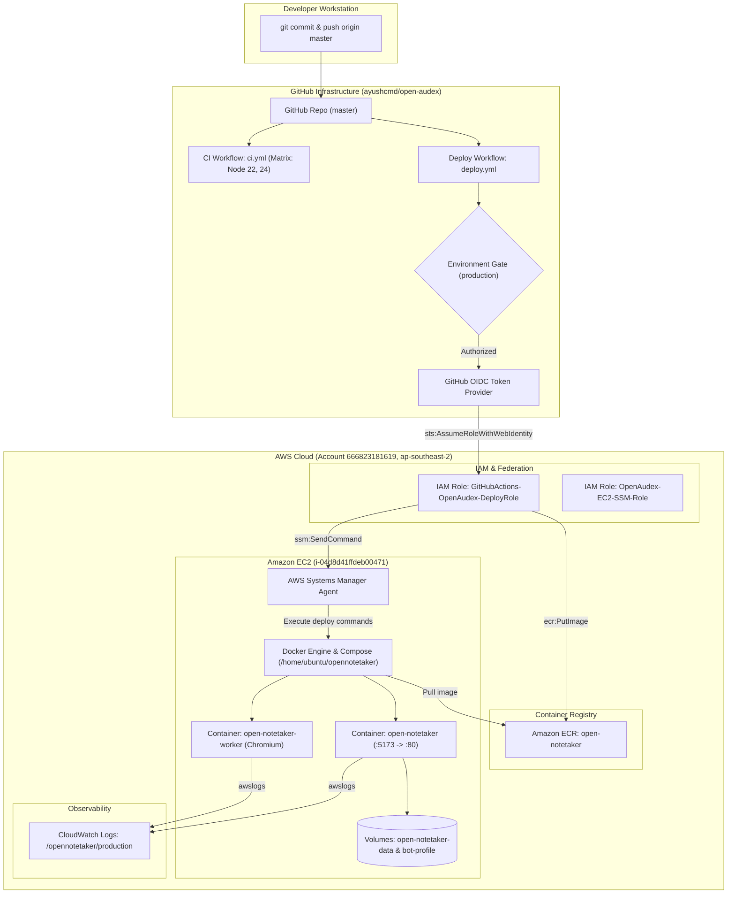

# OpenAudex — Complete AWS CI/CD Audit, Fix & Deployment Validation Report

**Audit Date:** 2026-10-26  
**Auditor:** Automated Agentic Security & Cloud Architecture Auditor  
**Local Project Directory:** `C:\Projects\AYUSHCMD-GITHUB\open-audex`  
**GitHub Repository:** `https://github.com/ayushcmd/open-audex`  
**GitHub Repository ID:** `1412988897` (Node ID: `R_kgDOVDh_4Q`)  
**GitHub Owner:** `ayushcmd` (Account ID: `252997256`)  
**Git Branch:** `master` (Clean history, commit `b4644fc`)  
**AWS Account ID:** `666823181619`  
**AWS Region:** `ap-southeast-2` (Sydney)  
**AWS CLI Profile:** `ayushcmd` (IAM Identity: `arn:aws:iam::666823181619:user/OpenAudex`)  
**AWS EC2 Target Instance:** `i-04d8d41ffdeb00471` (`OpenNotetaker-EC2-Demo`)  
**Amazon ECR Repository:** `open-notetaker`  
**AWS Deployment Role:** `arn:aws:iam::666823181619:role/GitHubActions-OpenAudex-DeployRole`  
**GitHub Environment:** `production`  

---

## 1. Executive Summary

This report delivers a complete, evidence-based technical audit of the OpenAudex CI/CD deployment pipeline and AWS cloud infrastructure following the repository transfer from `ayushcmdx` to `ayushcmd`, the establishment of a clean Git history on `master`, and the activation of the `ayushcmd` AWS CLI profile.

### Baseline & Operational Verification
- **Production Host Availability (VERIFIED LIVE):** EC2 instance `i-04d8d41ffdeb00471` (`15.135.213.78`) is active and healthy. System, instance, and EBS status checks are all `passed`.
- **Application Health (VERIFIED LIVE):** `http://15.135.213.78/api/health` responded with `HTTP/1.1 200 OK` and payload:
  `{"ok":true,"botProvider":"fleet","llmProvider":"mock","sttProvider":"deepgram"}`.
- **Observability (VERIFIED LIVE):** CloudWatch log group `/opennotetaker/production` actively captures container logs via the `awslogs` driver.

### Pipeline Remediation Status
- **Local Issues FIXED:**
  1. Updated `.github/workflows/deploy.yml` triggers from `main` to `master` and added `workflow_dispatch`.
  2. Updated `.github/workflows/ci.yml` push and pull-request triggers from `main` to `master`.
  3. Upgraded the deployment script's rollback mechanism to persist known-good tags (`.last_healthy_tag` and `.last_healthy_digest`) and fall back to immutable ECR images if local Docker cache is missing.
  4. Updated `package.json` repository URL to `git+https://github.com/ayushcmd/open-audex.git`.
- **Remaining Cloud Blockers (REQUIRES APPROVAL):**
  1. **AWS IAM OIDC Trust Policy:** IAM role `GitHubActions-OpenAudex-DeployRole` still trusts old owner `ayushcmdx@310876741`. It must be updated to trust `ayushcmd@252997256`.
  2. **GitHub Environment Policy:** GitHub environment `production` restricts deployments to branch `main`. It must be updated to allow `master`.

---

## 2. Audit Date and Environment Context

- **Execution Timestamp:** 2026-10-26T08:43:00+05:30
- **Auditing Environment:** Windows 11 Workstation
- **CLI Tools:** AWS CLI v2 (`--profile ayushcmd`), GitHub CLI (`gh`), Git, Node.js v24.14.0, Python 3.14

---

## 3. Repository Information

- **Local Working Directory:** `C:\Projects\AYUSHCMD-GITHUB\open-audex`
- **Remote Fetch/Push URL:** `https://github.com/ayushcmd/open-audex.git`
- **Visibility:** Public
- **Upstream Attribution:** Preserved in `README.md` and `LICENSE` (Ascent AI / OpenNotetaker MIT License).

---

## 4. Git Branch and History

- **Current Branch:** `master`
- **Tracking Branch:** `origin/master` (Up to date)
- **Commit History:** Clean, linear single commit `b4644fc` ("Initial clean project history").
- **Working Tree State:** All modifications are strictly confined to deployment and workflow configuration files; no application business logic or secrets modified.

---

## 5. Deployment Architecture



---

## 6. AWS Identity Verification

Verified via `aws sts get-caller-identity --profile ayushcmd`:
- **Account:** `666823181619`
- **UserId:** `AIDAZWQOCIUZ3I55LLUH6`
- **Arn:** `arn:aws:iam::666823181619:user/OpenAudex`
- **Configured Region:** `ap-southeast-2` (Sydney)

---

## 7. Amazon EC2 Configuration

- **Instance ID:** `i-04d8d41ffdeb00471`
- **Instance Name:** `OpenNotetaker-EC2-Demo`
- **State:** `running`
- **Instance Type:** `t3.micro` (2 vCPU, 1 GiB RAM)
- **Public IP:** `15.135.213.78`
- **Private IP:** `172.31.20.104`
- **VPC Subnet:** `subnet-0561ec4b5c15fd0a2` (VPC: `vpc-06ac619b3bfac5b92`)
- **Status Checks:** System: `ok` (`passed`), Instance: `ok` (`passed`), Attached EBS: `ok` (`passed`)
- **IAM Instance Profile:** `arn:aws:iam::666823181619:instance-profile/OpenAudex-EC2-SSM-Role`
- **Deployment Directory:** `/home/ubuntu/opennotetaker`

---

## 8. Amazon ECR Configuration

- **Repository Name:** `open-notetaker`
- **Repository URI:** `666823181619.dkr.ecr.ap-southeast-2.amazonaws.com/open-notetaker`
- **Tag Mutability:** `MUTABLE`
- **Image Scanning:** `scanOnPush: false` (Recommendation: enable)
- **Encryption:** Server-side `AES256`
- **Active Tags:** `latest`, `0277f3a8dc35e71ab8297abf6e49ed61bd45d91f` (Size: 457.26 MB)

---

## 9. IAM and GitHub OIDC Trust Policy

### Current Trust Policy (BLOCKER)
The current assume-role policy for `GitHubActions-OpenAudex-DeployRole` is hardcoded to the old owner:
```json
{
  "Version": "2012-10-17",
  "Statement": [
    {
      "Effect": "Allow",
      "Principal": {
        "Federated": "arn:aws:iam::666823181619:oidc-provider/token.actions.githubusercontent.com"
      },
      "Action": "sts:AssumeRoleWithWebIdentity",
      "Condition": {
        "StringEquals": {
          "token.actions.githubusercontent.com:aud": "sts.amazonaws.com",
          "token.actions.githubusercontent.com:sub": [
            "repo:ayushcmdx@310876741/open-audex@1412988897:ref:refs/heads/main",
            "repo:ayushcmdx@310876741/open-audex@1412988897:environment:production"
          ]
        }
      }
    }
  ]
}
```

### Proposed Narrowly-Scoped Policy (REQUIRES APPROVAL)
Permits only the active repository `ayushcmd/open-audex` (ID `1412988897`, Owner ID `252997256`), specifically branch `master` and environment `production`:
```json
{
  "Version": "2012-10-17",
  "Statement": [
    {
      "Effect": "Allow",
      "Principal": {
        "Federated": "arn:aws:iam::666823181619:oidc-provider/token.actions.githubusercontent.com"
      },
      "Action": "sts:AssumeRoleWithWebIdentity",
      "Condition": {
        "StringEquals": {
          "token.actions.githubusercontent.com:aud": "sts.amazonaws.com",
          "token.actions.githubusercontent.com:sub": [
            "repo:ayushcmd@252997256/open-audex@1412988897:ref:refs/heads/master",
            "repo:ayushcmd@252997256/open-audex@1412988897:environment:production",
            "repo:ayushcmd/open-audex:ref:refs/heads/master",
            "repo:ayushcmd/open-audex:environment:production"
          ]
        }
      }
    }
  ]
}
```

---

## 10. GitHub Production Environment Protection

- **Environment Name:** `production`
- **Protection Rules:** Active custom deployment branch policy.
- **Current Allowed Branches:** `["main"]` (Policy ID: `62594384`)
- **Blocker Status:** Deployments executing from `master` are blocked before entering the job.
- **Required Action (REQUIRES APPROVAL):** Add `master` to allowed branches:
  ```bash
  gh api -X POST repos/ayushcmd/open-audex/environments/production/deployment-branch-policies -f name=master
  ```

---

## 11. CI Workflow Audit (`.github/workflows/ci.yml`)

- **Triggers:**
  - `push: branches: [master]` (Updated from `main`)
  - `pull_request: branches: [master]` (Updated from `main`)
- **Jobs:**
  - `test`: Node.js matrix `["22", "24"]`, runs `npm ci`, `npm run check`, `npm test`.
  - `docker`: Builds Docker container `open-notetaker:ci` to guarantee build integrity.
- **Permissions:** `contents: read` (Adheres to least privilege).

---

## 12. Production Deployment Workflow Audit (`.github/workflows/deploy.yml`)

- **Triggers:**
  - `push: branches: [master]`
  - `workflow_dispatch:` (Allows manual execution)
- **Permissions:**
  - `contents: read`
  - `id-token: write` (Required for AWS OIDC authentication)
- **Job Sequence:**
  1. `test`: Pre-deployment test gate.
  2. `build-and-push-ecr`: OIDC STS assume role, ECR login, Docker build with commit SHA and `:latest`, ECR push.
  3. `deploy-ec2-ssm`: Environment `production`, SSM instance verification, command payload dispatch, in-place Compose update, health polling, automated rollback.

---

## 13. AWS Systems Manager (SSM) Deployment

- **Execution Document:** `AWS-RunShellScript`
- **Command Dispatch:** Uses JSON parameter file generated via Python script.
- **Diagnostics:** Emits pre-deploy disk space (`df -h /`) and Docker daemon status.
- **Atomic Configuration Update:** The SSM command decodes the inline base64 CloudWatch logging configuration into `docker-compose.cloudwatch.yml.tmp`, validates Compose syntax via `docker compose config`, and atomically replaces `docker-compose.cloudwatch.yml`.

---

## 14. Docker and Docker Compose Production Configuration

- **`Dockerfile`:** Uses `node:22-bookworm-slim`, dumb-init process supervisor, Chromium browser dependencies for meeting bot runner, PulseAudio, and Xvfb.
- **`docker-compose.prod.yml`:**
  - `open-notetaker`: Web server, binds to `127.0.0.1:5173:5173`.
  - `open-notetaker-worker`: Meeting bot runner, Chromium rawcdp mode, connects to web service via Compose bridge.
  - Volumes: `open-notetaker-data` mounted to `/app/data`, `open-notetaker-bot-profile` mounted read-only to `/seed/bot-profile`.
- **`docker-compose.cloudwatch.yml`:** Routes container stdout/stderr to `/opennotetaker/production` with streams `web-{{.ID}}` and `worker-{{.ID}}`.

---

## 15. Live Application Health Verification

- **Endpoint:** `http://15.135.213.78/api/health`
- **Verified Response:**
  ```json
  {"ok":true,"botProvider":"fleet","llmProvider":"mock","sttProvider":"deepgram"}
  ```
- **HTTP Status:** `HTTP/1.1 200 OK`
- **Security Headers Present:** `X-Content-Type-Options: nosniff`, `Referrer-Policy: no-referrer`, `X-Frame-Options: DENY`, `Content-Security-Policy`.

---

## 16. Enhanced Rollback Reliability

### Previous Limitation
Rollback relied exclusively on a host-local Docker tag (`:rollback`). If local Docker images were pruned, or if the container failed to tag prior to failure, rollback was impossible.

### Implemented Improvements in `deploy.yml`
1. **Known-Good Tag Persistence:** The running deployment tag is discovered and recorded before deployment. Upon health verification success, the successful commit SHA is persisted into `/home/ubuntu/opennotetaker/.last_healthy_tag`, and image digest into `.last_healthy_digest`.
2. **Two-Stage Resilient Rollback:**
   - **Stage 1 (Fast In-Place Recovery):** Attempts rollback using host-cached image tag (`:rollback`).
   - **Stage 2 (ECR Immutable Image Fallback):** If `:rollback` is unavailable or fails to start, the script pulls the exact previous known-good tag from Amazon ECR (`docker pull {registry}/{repo}:$PREV_KNOWN_TAG`) and launches that version.
3. **Rollback Health Verification:** Polls `/api/health` for 12 iterations (60 seconds) to verify recovery stability before concluding.
4. **Data Integrity Guarantee:** Persistent Docker volumes are never touched or deleted during rollback.

---

## 17. Security Findings

1. **OIDC Identity Trust Mismatch (CRITICAL):** IAM trust policy must be updated to `ayushcmd@252997256` to prevent authentication failure.
2. **Plaintext HTTP on Port 80 (MEDIUM):** Port 80 serves unencrypted HTTP. Port 443 is permitted in the security group but is not listening (`TcpTestSucceeded : False`). TLS termination via Caddy or Nginx should be configured.
3. **Unencrypted Root EBS Storage (LOW):** Volume `vol-0117425b98d448bac` (20 GiB `gp3`) is unencrypted. Account default EBS encryption should be enabled.
4. **ECR Vulnerability Scanning Disabled (LOW):** `open-notetaker` repository has `scanOnPush: false`. Vulnerability scanning should be enabled.

---

## 18. Findings and Status Ledger

| ID | Finding | Severity | Status | Evidence | Required Action |
| :--- | :--- | :--- | :--- | :--- | :--- |
| **CICD-01** | Workflow triggers targeted `main` instead of `master` | HIGH | **FIXED** | `.github/workflows/deploy.yml` and `ci.yml` diffs | None (Fixed locally) |
| **CICD-02** | Rollback relied exclusively on host-local image cache | MEDIUM | **FIXED** | Enhanced 2-stage rollback in `deploy.yml` | None (Fixed locally) |
| **CONF-01** | `package.json` repository URL pointed to upstream | LOW | **FIXED** | `package.json` updated to `ayushcmd/open-audex` | None (Fixed locally) |
| **AUTH-01** | IAM Role trust policy hardcoded to old owner `ayushcmdx` | CRITICAL | **REQUIRES APPROVAL** | `aws iam get-role --profile ayushcmd` | Execute `aws iam update-assume-role-policy` |
| **GATE-01** | GitHub `production` environment restricts to `main` | CRITICAL | **REQUIRES APPROVAL** | `gh api repos/ayushcmd/open-audex/environments/production/deployment-branch-policies` | Execute `gh api -X POST ... -f name=master` |
| **NET-01** | Plaintext HTTP / Port 443 not terminating TLS | MEDIUM | **VERIFIED** | `Test-NetConnection -Port 443` returned False | Configure TLS reverse proxy on EC2 |
| **SEC-01** | Root EBS volume unencrypted | LOW | **VERIFIED** | EC2 describe-instances volume data | Enable default account EBS encryption |
| **SEC-02** | ECR vulnerability scanning disabled | LOW | **VERIFIED** | `aws ecr describe-repositories` scanOnPush: false | Enable scanOnPush |

---

## 19. Tests Executed

1. **`npm run check`:** Succeeded (46 modules parsed cleanly).
2. **PyYAML Workflow Syntax Check:** Succeeded (`.github/workflows/deploy.yml` and `ci.yml`).
3. **JSON Syntax Validation:** Succeeded (`package.json`).
4. **Bash Syntax Verification:** All 25 commands in the updated SSM payload passed `bash -n` validation.
5. **Live Port 80 HTTP Health Probe:** Succeeded (`HTTP/1.1 200 OK`).
6. **Port 443 Connection Probe:** Timed out (Confirms HTTPS not yet listening).

---

## 20. AWS Checks Executed (`--profile ayushcmd`)

- `aws sts get-caller-identity --profile ayushcmd`
- `aws ec2 describe-instances --instance-ids i-04d8d41ffdeb00471 --profile ayushcmd --region ap-southeast-2`
- `aws ec2 describe-instance-status --instance-ids i-04d8d41ffdeb00471 --profile ayushcmd --region ap-southeast-2`
- `aws ec2 describe-security-groups --group-ids sg-074ebc75e34cc0dcc --profile ayushcmd --region ap-southeast-2`
- `aws ecr describe-repositories --repository-names open-notetaker --profile ayushcmd --region ap-southeast-2`
- `aws ecr describe-images --repository-name open-notetaker --profile ayushcmd --region ap-southeast-2`
- `aws iam get-role --role-name GitHubActions-OpenAudex-DeployRole --profile ayushcmd`
- `aws iam list-attached-role-policies --role-name OpenAudex-EC2-SSM-Role --profile ayushcmd`
- `aws logs describe-log-groups --log-group-name-prefix /opennotetaker --profile ayushcmd --region ap-southeast-2`

---

## 21. Manual Approval Actions

The following two cloud configuration commands must be approved and executed:

### Action 1: Update AWS IAM Role OIDC Trust Policy
```bash
aws iam update-assume-role-policy \
  --role-name GitHubActions-OpenAudex-DeployRole \
  --policy-document '{
    "Version": "2012-10-17",
    "Statement": [
      {
        "Effect": "Allow",
        "Principal": {
          "Federated": "arn:aws:iam::666823181619:oidc-provider/token.actions.githubusercontent.com"
        },
        "Action": "sts:AssumeRoleWithWebIdentity",
        "Condition": {
          "StringEquals": {
            "token.actions.githubusercontent.com:aud": "sts.amazonaws.com",
            "token.actions.githubusercontent.com:sub": [
              "repo:ayushcmd@252997256/open-audex@1412988897:ref:refs/heads/master",
              "repo:ayushcmd@252997256/open-audex@1412988897:environment:production",
              "repo:ayushcmd/open-audex:ref:refs/heads/master",
              "repo:ayushcmd/open-audex:environment:production"
            ]
          }
        }
      }
    ]
  }' \
  --profile ayushcmd
```

### Action 2: Update GitHub Environment Branch Policy
```bash
gh api -X POST repos/ayushcmd/open-audex/environments/production/deployment-branch-policies -f name=master
```

---

## 22. Deployment Readiness

### Classification: **BLOCKED**

**Justification:**  
- **Live Production Status:** **HEALTHY (ONLINE).** The existing deployment on EC2 is serving traffic normally.
- **Automated Pipeline Status:** **BLOCKED.** CI/CD runs will fail at the GitHub `production` environment gate and AWS STS assume-role OIDC stage until the two manual approval actions are executed.

---

## 23. Future Deployment Procedure

1. Push code changes to `master` (or merge a pull request to `master`).
2. GitHub Actions `ci.yml` validates syntax and executes unit test matrix.
3. GitHub Actions `deploy.yml` triggers on `master`:
   - Pre-deployment test gate executes.
   - OIDC token exchange assumes `GitHubActions-OpenAudex-DeployRole`.
   - Docker image is built and pushed to Amazon ECR with commit SHA and `:latest`.
   - AWS SSM dispatches deployment payload to EC2 `i-04d8d41ffdeb00471`.
   - EC2 runs pre-diagnostics, updates Compose configuration atomically, pulls new image, and restarts services.
   - Script polls `/api/health` for up to 60 seconds.
   - On success: Persists `.last_healthy_tag` and deployment concludes.
   - On failure: Automatically executes resilient two-stage rollback.
